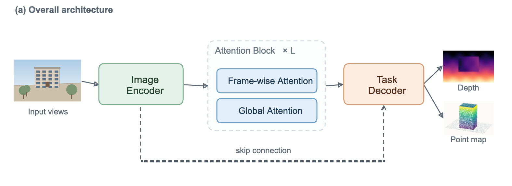
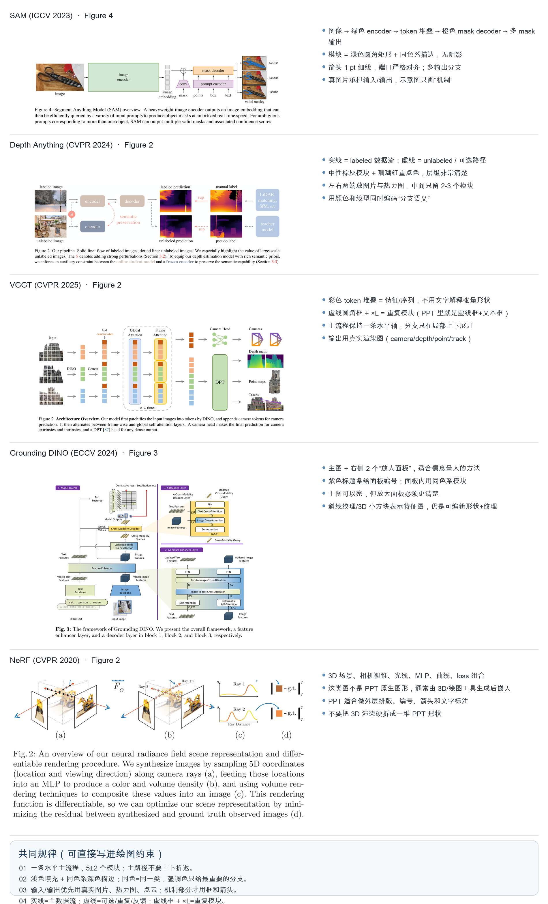
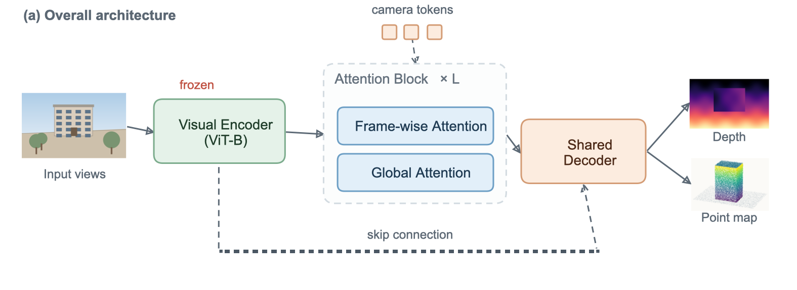

# pptdraw：让 AI 和你一起改同一份 PPT

[](https://github.com/Teddy-Yangjiale/Draw/actions/workflows/ci.yml)

这不是“让 AI 生成一张图片”，而是：

- **AI 直接编辑真实的 `.pptx`**：新增/修改模块框、箭头、虚线容器、图片、标签；
- **你可以在 WPS / PowerPoint 里继续拖拽、改字、换色、加图**；
- **AI 下次能重新读回你的改动**，在同一个文件上继续改，而不是推倒重来。

所有图形都是 PowerPoint 原生对象，文字是真文字，箭头是原生连接符，不是一张不可编辑的截图。



---

## 为什么是 PPT，而不是直接生成图片？

| 方案 | 问题 |
|---|---|
| AI 直接生成位图 | 文字糊、不可编辑、不可复现；审稿人放大看会露馅 |
| AI 生成 SVG/代码图 | 可编辑性差；你很难在投稿前手动微调 |
| AI 直接写 OOXML | LLM 容易写坏文件；出错难定位；人也看不懂 |
| **AI 操作原生 PPT 形状** | **可编辑、可回读、可版本化；你能接着改** |

顶会论文里的方法总览图，绝大多数本来就是“模块框 + 细箭头 + 虚线容器 + 图片/热力图”的组合。我们拆了 5 篇论文验证这件事：见 [`research/figure_analysis.md`](research/figure_analysis.md)。



---

## 核心设计：PPTX 是唯一事实来源

```
你/AI 描述 figure
        │
        ▼
AI 生成 ops.json（语义操作，不是 OOXML）
        │
        ▼
pptdraw apply ──► figure.pptx（原生形状/文本/连接符/图片）
        │                 │
        │                 ├──► 你在 WPS/PowerPoint 里继续改
        │                 │
        ▼                 ▼
pptdraw render ◄── figure.pptx  ◄── 你保存
        │                 │
        ▼                 ▼
     PNG 预览        pptdraw inspect
（AI 视觉自查）      （AI 读回你的改动）
        │
        └──────────────► 下一轮 ops.json
```

三个关键点：

1. **AI 不碰原始 XML**，只发 `ops.json`。失败可定位、可回滚，也方便审计。
2. **每个对象有语义名字**，例如 `fig.encoder`、`fig.edge.encoder--attention`、`fig.container.attention`。人可以在 PPT 的“选择窗格”里看到这些名字。
3. **主流程箭头是挂接在形状上的原生连接符**。你拖动模块，箭头会跟着走；AI 重新扫描时看到的是新位置。

---

## 快速开始

### macOS / Linux

```bash
git clone https://github.com/Teddy-Yangjiale/Draw.git
cd Draw
python3 -m pip install -e ".[demo,preview]"

./draw doctor
./draw demo out/cvpr_demo.pptx --png out/cvpr_demo.png
open out/cvpr_demo.pptx          # macOS; Linux 用 libreoffice 或 WPS 打开
```

### Windows

```bat
git clone https://github.com/Teddy-Yangjiale/Draw.git
cd Draw
py -m pip install -e ".[demo,preview]"

draw.cmd doctor
draw.cmd demo out\cvpr_demo.pptx --png out\cvpr_demo.png
start out\cvpr_demo.pptx
```

Windows 也可以直接用 PowerShell：

```powershell
.\draw.ps1 doctor
.\draw.ps1 demo out\cvpr_demo.pptx
```

或者安装后使用控制台命令：

```bash
pptdraw doctor
pptdraw demo out/cvpr_demo.pptx --png out/cvpr_demo.png
```

> 示例里的输入图、深度图、点云是程序生成的**占位图**；换成你自己的实验结果即可。

### 完整工作流

```bash
# 1. 检查环境
./draw doctor

# 2. 生成一个 CVPR 风格示例（同时导出 PNG）
./draw demo out/cvpr_demo.pptx --png out/cvpr_demo.png

# 3. 用 WPS/PowerPoint 打开，直接拖拽/改字/换色
open -a wpsoffice out/cvpr_demo.pptx     # macOS
# Windows: start out\cvpr_demo.pptx

# 4. AI 读取当前 PPT（包括你刚改的内容）
./draw inspect out/cvpr_demo.pptx

# 5. AI 应用一轮修改（示例：改文案、加 frozen 标记、加 camera token 分支）
./draw apply out/cvpr_demo.pptx examples/edit_example.json \
  --png out/cvpr_demo_edited.png

# 6. 机械检查
./draw lint out/cvpr_demo.pptx
```

单栏论文图：

```bash
./draw new out/single_column.pptx --size 3.5x2.6
```

定性对比图（图片网格）：

```bash
./draw new out/grid.pptx --size 3.5x2.3
./draw apply out/grid.pptx examples/image_grid.json --png out/grid.png
```

---

## 跨平台支持

| 平台 | 命令入口 | 自动预览 |
|---|---|---|
| macOS | `./draw` 或 `pptdraw` | WPS Quick Look（推荐，已装 WPS 即可）；LibreOffice |
| Windows | `draw.cmd` / `draw.ps1` / `py -m pptdraw` / `pptdraw` | LibreOffice；或 PowerPoint COM |
| Linux | `./draw` 或 `pptdraw` | LibreOffice |

- **核心功能（apply / inspect / lint / undo）是纯 Python**，不依赖操作系统；生成的 `.pptx` 在 macOS、Windows、Linux 的 WPS/PowerPoint 里都能打开和编辑。
- **预览引擎是可选适配层**：macOS 用 Quick Look，Windows 用 LibreOffice 或 PowerPoint COM，Linux 用 LibreOffice。没有预览引擎时，AI 仍然可以用 `inspect` 的坐标/文字做布局，只是不能看 PNG。
- CI 会在 **Ubuntu / macOS / Windows** 上跑单元测试和端到端 demo；见 `.github/workflows/ci.yml`。

### Windows 预览说明

- 推荐安装 [LibreOffice](https://www.libreoffice.org/download/download/)，无需额外 Python 包；`pptdraw render` 会自动找到 `soffice.exe`。
- 如果只装了 PowerPoint，`pptdraw render` 会尝试用 PowerShell COM 导出当前页；PowerPoint 会短暂打开，导出后自动关闭。自动化权限被安全软件拦截时，请改用 LibreOffice。
- `pptdraw export-pdf` 需要 LibreOffice；如果只有 PowerPoint/WPS，直接在应用里“另存为 PDF”更稳。

### 字体（Linux / 无 Arial Unicode 的环境）

PPTX 默认使用 `Arial` + `Arial Unicode MS`。如果目标机器缺字体，用环境变量覆盖：

```bash
export PPT_DRAW_PPT_FONT="Liberation Sans"
export PPT_DRAW_EA_FONT="Noto Sans CJK SC"
export PPT_DRAW_FONT="/usr/share/fonts/opentype/noto/NotoSansCJK-Regular.ttc"
```

- `PPT_DRAW_PPT_FONT`：PPTX 里拉丁文字体名。
- `PPT_DRAW_EA_FONT`：PPTX 里中日韩文字体名。
- `PPT_DRAW_FONT`：程序用来测量文字宽度/换行的字体文件（必须是 TTF/TTC）。

---

## 常用命令

`./draw` 是 macOS/Linux 的便捷包装；安装后也可以用 `pptdraw`，Windows 用 `draw.cmd` 或 `py -m pptdraw`。

| 命令 | 作用 |
|---|---|
| `pptdraw doctor` | 检查字体、Quick Look、LibreOffice、PowerPoint、WPS |
| `pptdraw new FILE [--size 7.16x2.6]` | 新建空白单页图 |
| `pptdraw demo FILE [--png]` | 生成 CVPR 风格示例 |
| `pptdraw inspect FILE [--json] [--png PREVIEW]` | 输出 PPT 的结构化描述（AI 读这个） |
| `pptdraw apply DECK OPS.json [-o OUT] [--png]` | 应用语义编辑操作；默认原地保存并备份 |
| `pptdraw render FILE -o PNG [--dpi 300]` | 渲染某页为 PNG |
| `pptdraw lint FILE` | 检查重叠、文字溢出、越界、字号、重名 |
| `pptdraw undo FILE` | 恢复到最近一次 AI 修改前的备份 |
| `pptdraw export-pdf FILE -o PDF` | 有 LibreOffice 时导出矢量 PDF |

`apply` 默认在 `DECK` 同级目录的 `.pptdraw/history/` 里留备份；`undo` 恢复最近一份。

### 安装选项

```bash
python3 -m pip install -e .              # 核心：apply/inspect/lint
python3 -m pip install -e ".[demo,preview]"  # 示例图 + LibreOffice PDF 预览
python3 -m pip install -e ".[preview]"   # 加 PyMuPDF，LibreOffice PDF -> PNG
python3 -m pip install -e ".[dev]"       # 加 pytest/ruff
```

`requirements.txt` 仍然保留，适合直接 `pip install -r requirements.txt`。

### 测试

```bash
python3 -m pytest
```

CI 会在 Ubuntu、macOS、Windows 上安装仓库、运行单元测试，并执行一次 `demo -> inspect -> lint` 端到端流程。

---

## AI 如何“直接编辑”PPT

AI 输出的是一组语义操作，例如：

```json
{
  "slide": 1,
  "ops": [
    {
      "op": "add_shape",
      "name": "fig.encoder",
      "shape": "roundRect",
      "x": 1.38, "y": 0.90, "w": 1.18, "h": 0.58,
      "text": "Image\nEncoder",
      "style": "green",
      "font_size": 10.0
    },
    {
      "op": "add_connector",
      "name": "fig.edge.encoder--attention",
      "from": "fig.encoder",
      "to": "fig.attention",
      "from_side": "right",
      "to_side": "left",
      "arrow": "end"
    },
    {
      "op": "add_container",
      "name": "fig.attention",
      "around": ["fig.attn.frame", "fig.attn.global"],
      "label": "Attention Block   × L"
    }
  ]
}
```

完整操作表见 [`docs/ops.md`](docs/ops.md)。支持：

- `add_shape` / `add_text` / `add_container`
- `add_connector`（原生连接符，自动挂接）
- `add_detour`（U 形 skip/feedback，挂接在形状上）
- `add_route`（自由折线，适合复杂绕线）
- `add_picture` / `add_image_grid`
- `move` / `resize` / `set_text` / `set_style` / `delete` / `rename`
- `align` / `distribute` / `layout_row` / `layout_column`
- `set_z` / `normalize_z` / `set_background` / `fit_canvas`

---

## 你改完 PPT 后，AI 怎么接上？

1. 关掉 WPS/PowerPoint 里的文件（避免 AI 写入时冲突）。
2. 保存你的修改。
3. 运行 `./draw inspect out/cvpr_demo.pptx`。
4. AI 看到的是**当前文件**：你移动过的位置、改过的文字、换过的颜色、加过的图片。
5. AI 生成下一轮 `ops.json`，只改它要改的对象，不动你其他的内容。

示例：


模拟“你在 WPS 里把 decoder 拖走并改字”后，AI 仍然能读到新位置，连接符也会跟着更新：



> 并发提醒：这是**文件级**协作，不是 Google Docs 式实时协同。AI 写入前请关闭文件；你编辑时不要让 AI 同时写。`apply` 会备份，`undo` 可回滚。

---

## 论文排版建议

- **双栏图**：`7.16 × 2.4–3.2 in`（CVPR/ICCV 双栏正文宽度约 7.16 in）。
- **单栏图**：`3.5 × 2.0–2.8 in`。
- **字号**：模块 9–11 pt，图片标注 8–9 pt；最终打印不要小于 8 pt。
- **线宽**：0.75–1.25 pt；箭头不要太粗。
- **颜色**：浅色填充 + 同色系描边；强调色只给最重要的分支。
- **导出**：在 WPS/PowerPoint 里“另存为 PDF”，得到矢量图；LaTeX 用 `\includegraphics{figure.pdf}`。不要用 PNG 投稿，除非期刊要求。
- **图注**：不要画在 PPT 里；图注交给 LaTeX/Word，图内只留 `(a)` `(b)` 这类面板编号。

---

## 目录结构

```
pptdraw/
  cli.py         命令行
  deck.py        新建画布
  ops.py         语义操作 -> 原生 PPTX
  inspect.py     PPTX -> AI 可读结构
  pptxutil.py    底层形状/文本/连接符/层级工具
  preview.py     PPTX -> PNG（Quick Look / LibreOffice / PowerPoint COM）
  quality.py     重叠/溢出/越界/字号/重名检查
  demo.py        CVPR 风格示例与人工修改模拟
  textutil.py    中英文混排测量与换行
  fonts.py       跨平台字体发现与覆盖
  style.py       论文风格色板
examples/
  edit_example.json
  image_grid.json
tests/            pytest 单元测试
.github/workflows/ci.yml   Ubuntu/macOS/Windows CI
research/
  figure_analysis.md      5 篇顶会论文拆解
  figure_analysis_sheet.png
  crops/                  已提交的裁图
  download_papers.py      按需下载原始 PDF
  render_pages.py         按需渲染整页截图
out/
  cvpr_demo.pptx / .png
  cvpr_demo_edited.pptx / .png
  cvpr_demo_human.pptx / .png
docs/ops.md
draw / draw.cmd / draw.ps1   三个平台入口
AGENTS.md      AI 操作协议（OpenCode 会自动读取）
PROMPT.md      给 ChatGPT/Claude 的复制粘贴提示词
```

---

## 当前限制

- **预览是近似渲染**：macOS 用 WPS 的 Quick Look；Windows 用 LibreOffice 或 PowerPoint COM；Linux 用 LibreOffice。最终效果以 WPS/PowerPoint 打开为准。
- **Windows 预览不是必装**：没有 LibreOffice/PowerPoint 时，`apply` / `inspect` / `lint` 仍可正常使用，只是不出 PNG。
- **一页一张图**：多页 PPT 可以渲染指定页，但工具主要面向“单页 figure”。
- **不做通用自动布局**：提供 `layout_row` / `layout_column` / `align` / `distribute`，复杂图由 AI 计算坐标；没有 Graphviz 式自动排图。
- **不做 3D 插画**：NeRF 那类 3D 场景请用 Blender/Matplotlib/论文代码渲染后作为图片导入；PPT 负责排版和标注。
- **不做 LaTeX 公式渲染**：可用 Unicode 下标/希腊字母，或把公式作为图片导入。
- **不做实时协同**：文件级编辑，注意关闭文件再让 AI 写。
- **字体**：默认 Arial + Arial Unicode MS；中文可正常显示。Linux 或缺少字体的机器用 `PPT_DRAW_PPT_FONT` / `PPT_DRAW_EA_FONT` / `PPT_DRAW_FONT` 覆盖。

## 跨平台验证

- 单元测试不依赖 GUI，覆盖：创建形状、容器、连接符、detour、图片网格、文字/样式修改、删除级联、分组读取、备份、CJK 文本。
- CI 矩阵：Ubuntu / macOS / Windows × Python 3.10 / 3.12。
- 生成的 `.pptx` 是标准 OOXML，macOS 生成后可直接拷贝到 Windows 的 WPS/PowerPoint 打开；反向同理。字体可能被目标机器替换，版式/连接关系/文字仍是可编辑的。

## 下一步可以加什么

- PowerPoint Office.js 插件：在打开的文件里实时应用 AI 修改（需要 PowerPoint，不是 WPS）。
- 从 PDF 图注自动生成初稿：解析方法章节 → 生成 `ops.json`。
- 视觉审稿器：检测箭头穿越模块、连线交叉、对齐偏差、颜色不协调。
- LaTeX 公式对象：把公式渲染成透明 PNG/SVG 后嵌入，或转成 OMML。
- 模板库：CVPR/ICCV/NeurIPS 常用图模板（pipeline、token stack、zoom-in、qualitative grid）。
