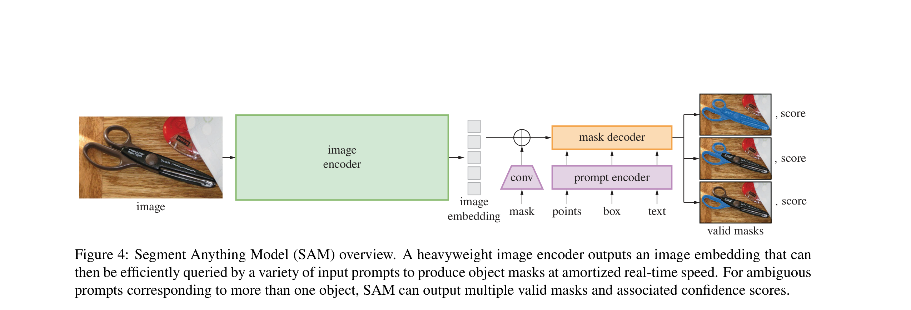
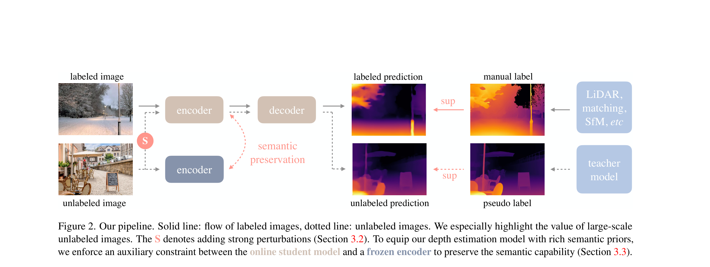
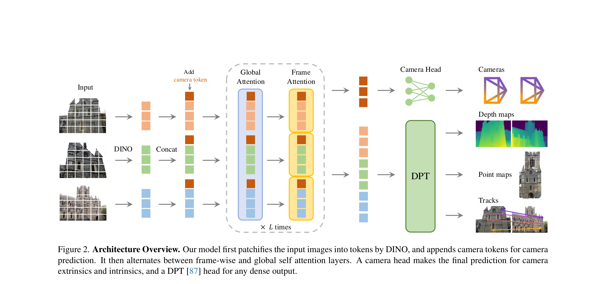
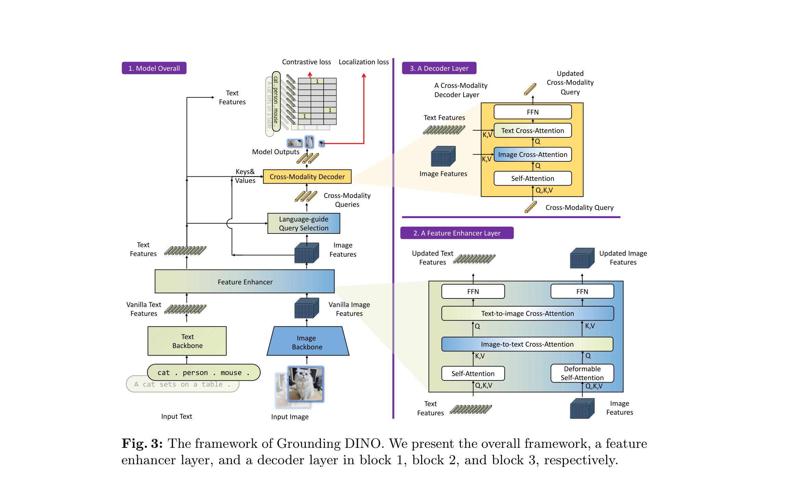
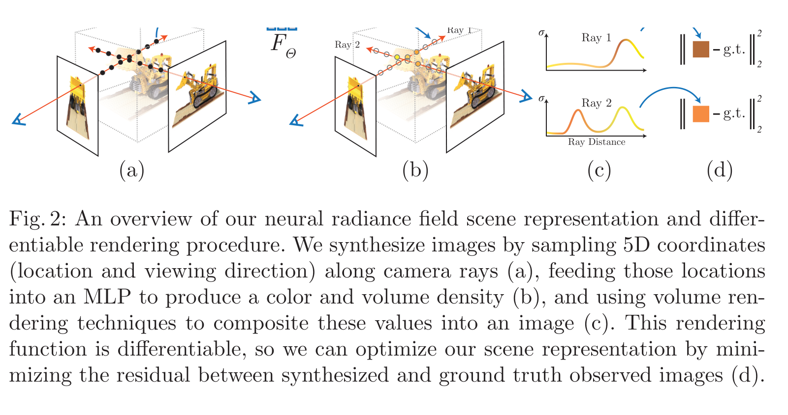

# 顶会论文示意图拆解

> 目的：先搞清楚 CVPR/ICCV/ECCV 论文里的“方法总览图”到底由哪些视觉元素组成，再决定程序该提供什么能力。
> 方法：从 arXiv 下载 PDF，用 PyMuPDF 以 300 dpi 渲染对应页面，裁出 Figure 区域；截图与原始 PDF 均保存在 `research/`。

## 样本

| 论文 | 会议 | 图 | 页面 | 链接 |
|---|---|---|---|---|
| Segment Anything (SAM) | ICCV 2023 | Fig. 4 | p.5 | https://arxiv.org/abs/2304.02643 |
| Depth Anything | CVPR 2024 | Fig. 2 | p.4 | https://arxiv.org/abs/2401.10891 |
| VGGT | CVPR 2025 | Fig. 2 | p.3 | https://arxiv.org/abs/2503.11651 |
| Grounding DINO | ECCV 2024 | Fig. 3 | p.5 | https://arxiv.org/abs/2303.05499 |
| NeRF | CVPR 2020 | Fig. 2 | p.5 | https://arxiv.org/abs/2003.08934 |

原始 PDF 不随仓库提交（体积较大），可用 `python research/download_papers.py` 重新下载；整页截图可用 `python research/render_pages.py` 重新生成。裁图已提交在 `research/crops/`，所以不下载 PDF 也能阅读本分析。

## 逐图观察

### 1. SAM：最标准的“横向流水线”

- 从左到右：真实图片 → 浅绿色 `image encoder` → 灰色 token 堆叠 → 橙色 `mask decoder` → 3 张 mask + score。
- 紫色 `prompt encoder` 从下方接入，用 `conv` 梯形表示卷积；箭头是 1 pt 细线，端口对齐。
- 颜色只承担“模块类别”：绿色=编码器，紫色=提示编码，橙色=解码器；没有阴影、渐变、立体边框。
- 输入/输出直接用照片；示意图只解释机制。
- 标签是短语，不是句子；字号明显小于正文，但打印后仍可读。

**可迁移到 PPT 的元素**：圆角矩形、梯形、堆叠小方块、图片、直线箭头、文本标签。

### 2. Depth Anything：用线型编码“数据流语义”

- 上支 labeled、下支 unlabeled；实线/虚线把两种数据流分开，读者不需要读图注就能看懂。
- 模块用低饱和的棕灰/蓝灰；重点路径（`S`、`semantic preservation`、`sup`）用珊瑚红，强调色只出现在关键处。
- 左端是真实图像，右端是深度热力图与伪标签；中间只保留 encoder/decoder 两个模块。
- “teacher model / LiDAR matching”放在最右侧，用浅蓝块表示外部监督源。

**可迁移到 PPT 的元素**：实线/虚线、强调色、图片+热力图、侧边输入块。

### 3. VGGT：用“堆叠”表达张量，用虚线框表达重复

- 输入图像打成 patch 后变成彩色 token 堆叠；不同颜色代表不同图像/帧。
- `Global Attention` / `Frame Attention` 上下叠放，外面一个灰色虚线圆角框，底部标 `× L times`。这在 PPT 里就是一个虚线框 + 两个小矩形 + 一个文本框。
- 主流程保持一条水平轴：Input → DINO/Concat → Attention → Camera Head / DPT → 输出。
- 输出不是文字列表，而是真实的 camera/depth/point/track 可视化缩略图。

**可迁移到 PPT 的元素**：token 堆叠、虚线容器、`×L`、真实输出缩略图。

### 4. Grounding DINO：主图 + 放大面板

- 左侧是主模型，右侧是 2 个放大面板（Feature Enhancer / Decoder Layer），用紫色标题条编号。
- 面板内部用同色系但更深/更浅的模块，形成层级；主图可以密，放大面板必须清楚。
- 特征图用斜线纹理矩形，3D 张量用小立方体；这些在 PPT 里可以用形状+纹理/小方块近似。
- 信息量大，但仍然保持“输入在左下、输出在右上”的阅读顺序。

**可迁移到 PPT 的元素**：面板标题条、放大面板、纹理矩形、立方体图标、分组虚线框。

### 5. NeRF：3D 插画，不是 PPT 原生图形

- 3D 场景、相机视锥、光线采样、MLP、体积渲染曲线、loss 组合在一起。
- 这类图通常由 3D 渲染/绘图工具生成，再嵌入论文；用 PPT 形状硬画会非常低效且不自然。
- PPT 适合做外层排版、编号 `(a)(b)(c)(d)`、箭头、公式和文字标注；3D 主体应作为图片导入。

**结论**：程序应优先服务“2D 方法总览/流程图/架构图”，并支持导入图片/渲染图；不要承诺用 PPT 形状生成 NeRF 级 3D 插画。

## 共同规律

1. **一条水平主流程，5±2 个模块**。主路径尽量不上下折返；分支只在局部展开。
2. **浅色填充 + 同色系深色描边**。同色=同一类；强调色只给最重要的一支。避免高饱和、渐变、阴影。
3. **输入/输出优先用真实图片/热力图/点云**。机制部分才用框和箭头；这样图既有信息量又不“PPT 味”。
4. **线型有语义**。实线=主数据流；虚线=可选/未标注/重复/反馈；虚线框+`×L`=重复模块。
5. **箭头细、端口对齐**。参考图多为 0.75–1.25 pt；箭头不要穿过模块；多输出用分支而不是多条斜线乱飞。
6. **文字短、字号小**。模块内 8–11 pt，短语/名词；不要写完整句子；图内不放标题和图注（图注交给 LaTeX）。
7. **白底、无装饰**。无阴影、无渐变、无 3D 立体框；留白均匀，边界留 0.1–0.2 in。
8. **面板化**。复杂方法用 `(a) Overall` + `(b) Detail`；面板标题条用同一色系，放大面板内部要更简洁。

## 对程序的设计要求

由此得出 `pptdraw` 的能力清单：

- 原生形状：圆角矩形、矩形、椭圆、菱形、梯形、六边形、平行四边形、圆柱、token 小方块。
- 原生连接线：可挂接形状的直线/折线连接符，支持箭头、虚线、端口选择。
- 虚线容器 + 标签，用于重复模块/分组。
- 图片与图片网格，用于输入/输出/定性对比。
- 原生文本，8–11 pt，支持中英文混排；文字绝不被转成图片。
- 语义化命名（`fig.encoder`、`fig.edge.encoder--decoder`），让人和 AI 都能定位对象。
- 可回读：人改完 PPT 后，AI 能重新扫描形状、文本、位置和连接关系。
- 机械检查：重叠、文字溢出、越界、字号过小、重名。
- 预览：把真实 PPTX 渲染成 PNG，供 AI 做视觉自查；最终以 WPS/PowerPoint 为准。

## 不做什么

- 不用 AI 生成位图来冒充“架构图”——文字会糊、不可编辑、不可复现。
- 不把整张图导出成一张图片再塞回 PPT——人就没法改。
- 不强行用 PPT 形状画 3D 场景/真实渲染图——这类内容应作为图片导入。
- 不让 LLM 直接写 OOXML——用受控的语义操作 API，失败可定位、可回滚。
