# 顶会论文示意图拆解（16 篇）

> 目的：从 CVPR / AAAI / NeurIPS / ICLR / ICML / SIGGRAPH 的真实论文图里，提炼出“图应该怎么画”的可执行规则，而不是泛泛谈审美。
>
> 方法：从 arXiv 下载 PDF → 用 PyMuPDF 渲染页面 → 裁出方法总览图 / 概念图 / 结果网格。PDF 不提交到仓库（体积大），截图与分析提交。

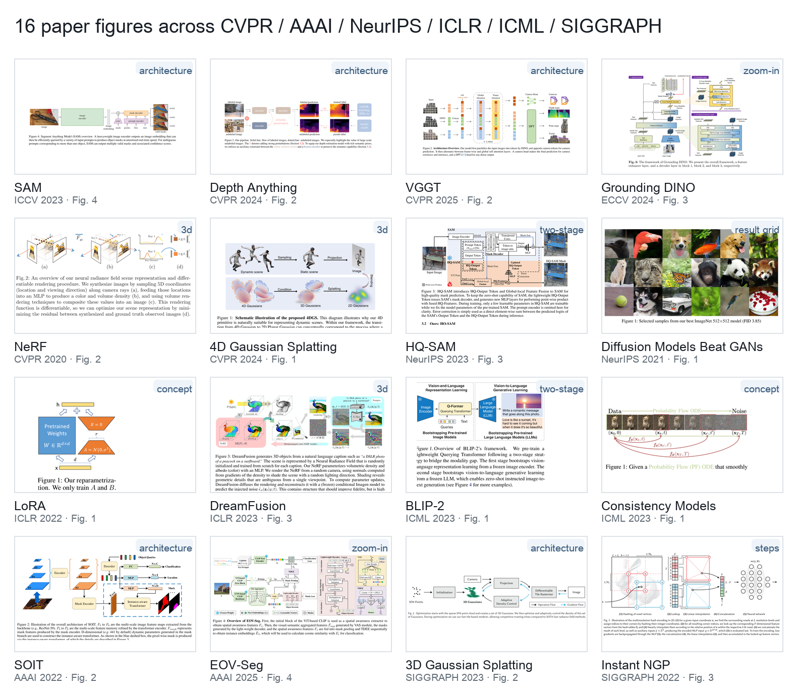

## 样本

| # | 论文 | 会议 | 图 | 页 | arXiv |
|---|---|---|---|---|---|
| 1 | Segment Anything (SAM) | ICCV 2023 | Fig. 4 | 5 | 2304.02643 |
| 2 | Depth Anything | CVPR 2024 | Fig. 2 | 4 | 2401.10891 |
| 3 | VGGT | CVPR 2025 | Fig. 2 | 3 | 2503.11651 |
| 4 | Grounding DINO | ECCV 2024 | Fig. 3 | 5 | 2303.05499 |
| 5 | NeRF | CVPR 2020 | Fig. 2 | 5 | 2003.08934 |
| 6 | 4D Gaussian Splatting | CVPR 2024 | Fig. 2 | 4 | 2310.10642 |
| 7 | HQ-SAM | NeurIPS 2023 | Fig. 3 | 4 | 2306.01567 |
| 8 | Diffusion Models Beat GANs | NeurIPS 2021 | Fig. 1 | 1 | 2105.05233 |
| 9 | LoRA | ICLR 2022 | Fig. 1 | 1 | 2106.09685 |
| 10 | DreamFusion | ICLR 2023 | Fig. 3 | 5 | 2209.14988 |
| 11 | BLIP-2 | ICML 2023 | Fig. 1 | 1 | 2301.12597 |
| 12 | Consistency Models | ICML 2023 | Fig. 1 | 1 | 2303.01469 |
| 13 | SOIT | AAAI 2022 | Fig. 2 | 3 | 2112.11037 |
| 14 | EOV-Seg | AAAI 2025 | Fig. 4 | 4 | 2412.08628 |
| 15 | 3D Gaussian Splatting | SIGGRAPH 2023 | Fig. 2 | 5 | 2308.04079 |
| 16 | Instant NGP | SIGGRAPH 2022 | Fig. 3 | 4 | 2201.05989 |

原始 PDF 不随仓库提交，运行：

```bash
python research/download_papers.py
python research/render_pages.py   # 可选：重新渲染整页截图
```

裁图已提交在 `research/crops/`，不下载 PDF 也能阅读本分析。

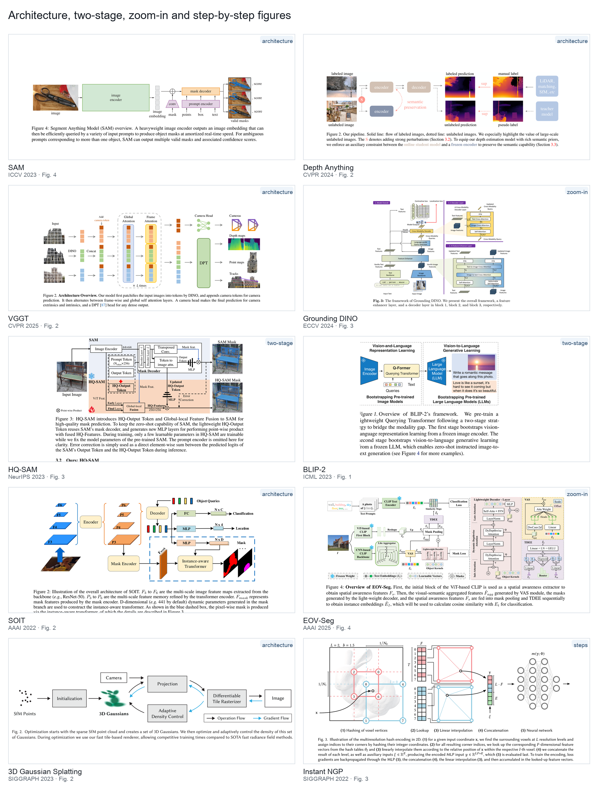

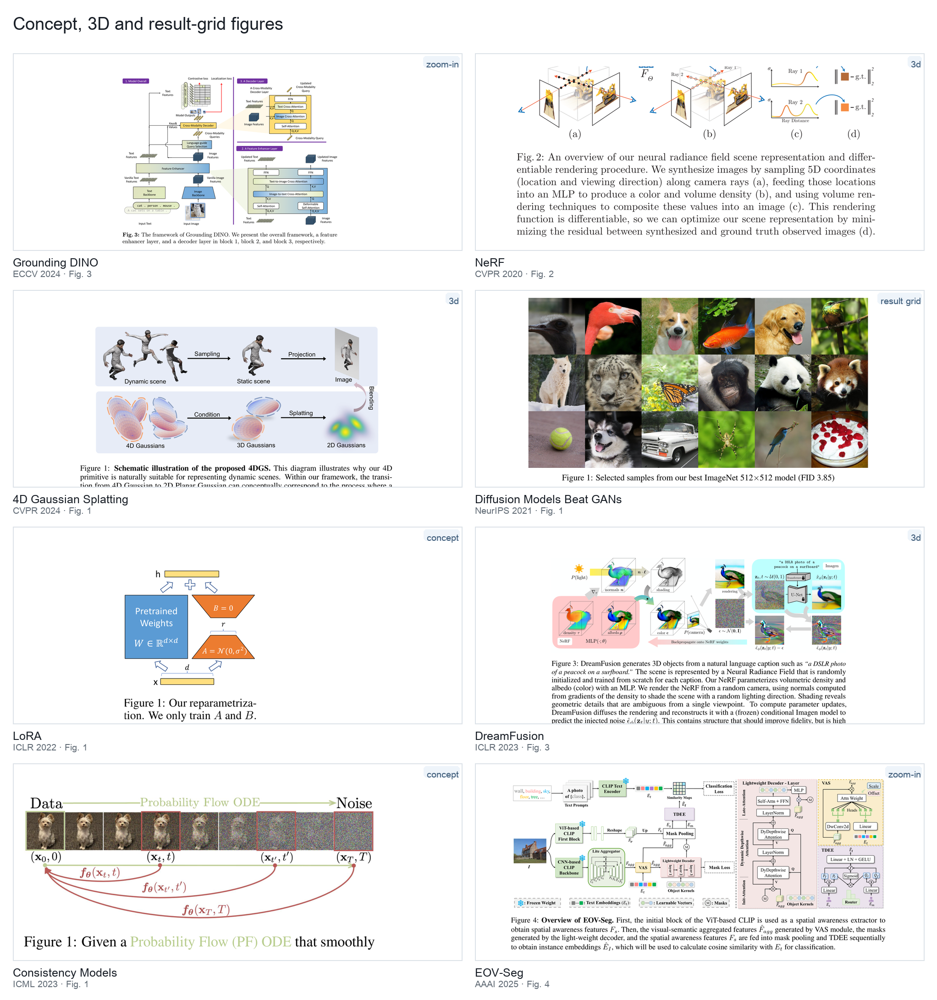

---

## 六种图型

| 图型 | 代表论文 | 什么时候用 | PPT 可行性 |
|---|---|---|---|
| 单主干架构 | SAM、Depth Anything、VGGT、SOIT、3DGS | 方法有清晰的 encoder→fusion→decoder 流程 | 很高，几乎全 PPT |
| 两阶段 / 冻结-可训练 | HQ-SAM、BLIP-2、LoRA、EOV-Seg | 有预训练模型、只训练一小部分、或两阶段训练 | 很高，虚线框+色块 |
| 逐步机制 | Instant NGP、Consistency Models | 需要解释一个关键操作/编码/轨迹 | 中高，网格/箭头/图片 |
| 主图+放大面板 | Grounding DINO、EOV-Seg、HQ-SAM | 系统复杂，细节多，需要局部放大 | 高，但信息密度大 |
| 3D/渲染概念 | NeRF、4DGS、DreamFusion、3DGS | 涉及 3D 场景、光线、Gaussian、渲染 | 低，3D 主体需导入 |
| 结果网格 / teaser | Diffusion Models Beat GANs、DreamFusion、3DGS | 用画质/多样性说话 | 高，图片网格 |
| 轨迹/概念映射 | Consistency Models、LoRA | 一个核心思想，用箭头/轨迹解释 | 高，图片+曲线/箭头 |

> 一张论文图通常混合 2 种图型：例如 DreamFusion = 3D 概念图 + 训练闭环；EOV-Seg = 主图 + 放大面板 + 图例。

---

## 逐篇观察

### 1. SAM（ICCV 2023）— 最标准的横向流水线


- 从左到右：真实图片 → 浅绿 `image encoder` → 灰色 token 堆叠 → 橙色 `mask decoder` → 3 张 mask + score。
- 紫色 prompt encoder 从下方接入；`conv` 用梯形；箭头 1 pt，端口对齐。
- 颜色只编码模块类别，没有阴影、渐变、3D 边框。
- 真实图片承担输入/输出，示意图只解释机制。

### 2. Depth Anything（CVPR 2024）— 线型编码数据流


- 上支 labeled、下支 unlabeled；实线/虚线区分两种数据流。
- 中性棕灰模块 + 珊瑚红重点色；`S`、`semantic preservation`、`sup` 用强调色。
- 左端真实图像，右端深度热力图与伪标签；中间只留 encoder/decoder。

### 3. VGGT（CVPR 2025）— token 堆叠 + 虚线重复块


- 彩色 token 堆叠表达 patch/feature，不需要文字解释张量形状。
- 灰色虚线圆角框 + `× L times` 表达重复模块。
- 主流程一条水平轴；输出用 camera/depth/point/track 的真实渲染缩略图。

### 4. Grounding DINO（ECCV 2024）— 主图 + 放大面板


- 左侧主模型，右侧 2 个放大面板（Feature Enhancer / Decoder Layer），紫色标题条编号。
- 面板内用同色系但更深/更浅的模块，形成层级。
- 特征图用斜线纹理矩形，3D 张量用小立方体；信息密度高但阅读顺序清楚。

### 5. NeRF（CVPR 2020）— 3D 插画


- 3D 场景、相机视锥、光线采样、MLP、体积渲染曲线、loss 组合。
- 这类图通常由 3D 渲染/绘图工具生成，再嵌入论文；用 PPT 形状硬画会低效且不自然。

### 6. 4D Gaussian Splatting（CVPR 2024）— 3D + 公式 + 流程

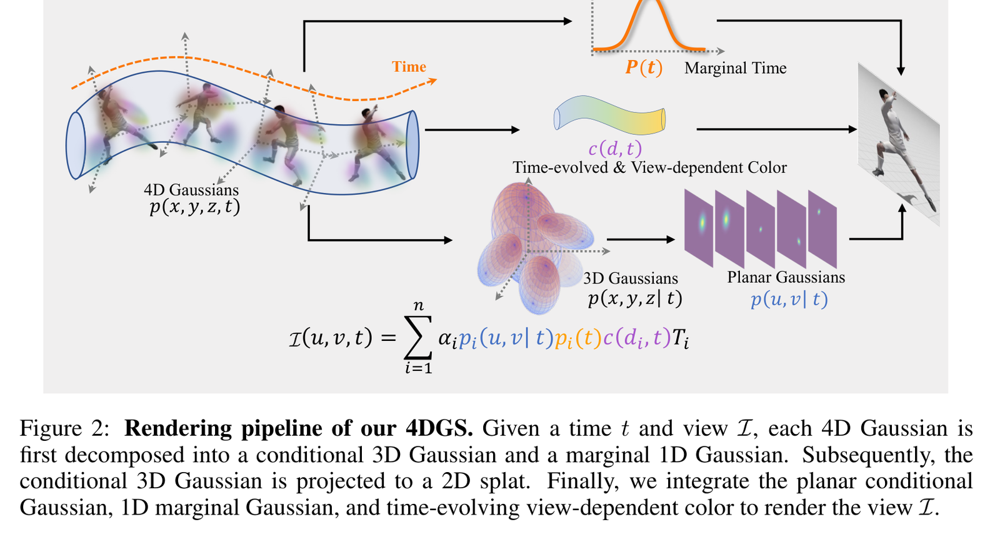

- 4D Gaussian 分解为 3D Gaussian + 1D marginal + 2D planar Gaussian，再渲染成图像。
- 3D 体积、时间轴、曲线、公式放在同一张图里；黑色箭头表示流程，颜色只标关键变量。
- 外层流程可以用 PPT 排，3D 体积/人物必须导入渲染图。

### 7. HQ-SAM（NeurIPS 2023）— 冻结/可训练双区

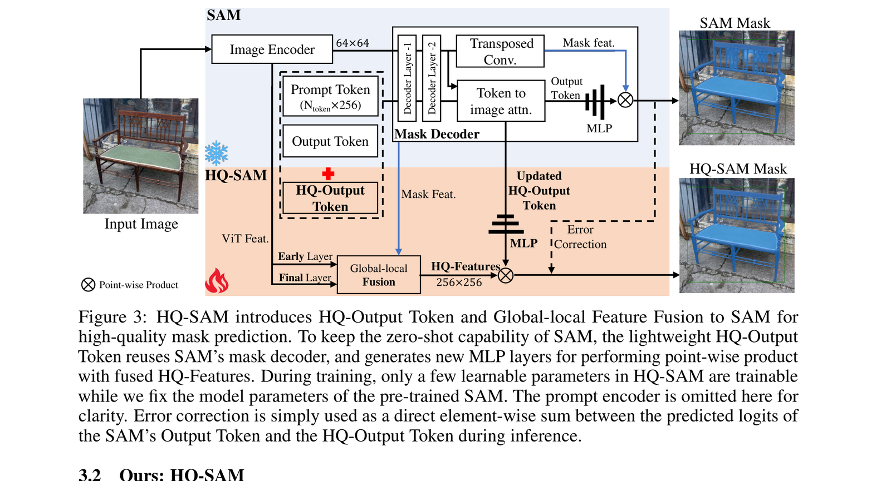

- 上半部分浅蓝 = 冻结的 SAM，下半部分浅橙 = 可训练的 HQ-SAM；雪花/火焰图标强化语义。
- 新模块 `HQ-Output Token` 用黑色虚线框；误差修正用粗虚线回路。
- 输入/输出用真实 mask 图，读者一眼知道改进了什么。

### 8. Diffusion Models Beat GANs（NeurIPS 2021）— 纯结果网格

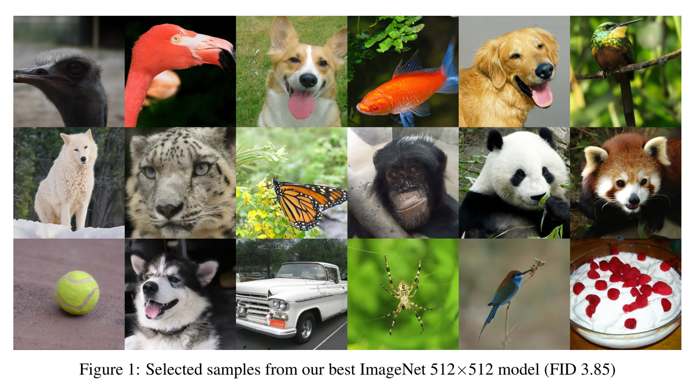

- 3×6 图片网格，无间距、无边框、无模块框；图注只写模型和 FID。
- 这类图的说服力来自图片质量，不来自箭头；PPT 只需精确对齐网格、统一尺寸、留白边距。
- 不要在结果网格上加装饰性边框/阴影。

### 9. LoRA（ICLR 2022）— 最小概念图

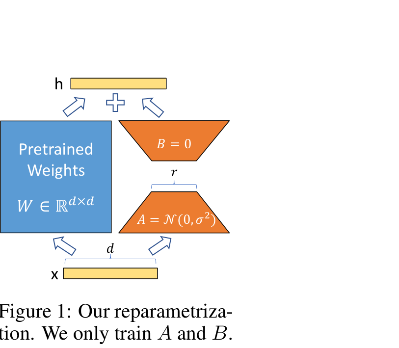

- 蓝色冻结权重矩阵 + 橙色可训练低秩 A/B；`+`、维度括号、箭头构成一个极简公式图。
- 面积很小，通常作为方法节的 inset；不需要复杂布局。
- 适合用 PPT 原生矩形/梯形/文本框精确复刻。

### 10. DreamFusion（ICLR 2023）— 3D + 扩散闭环

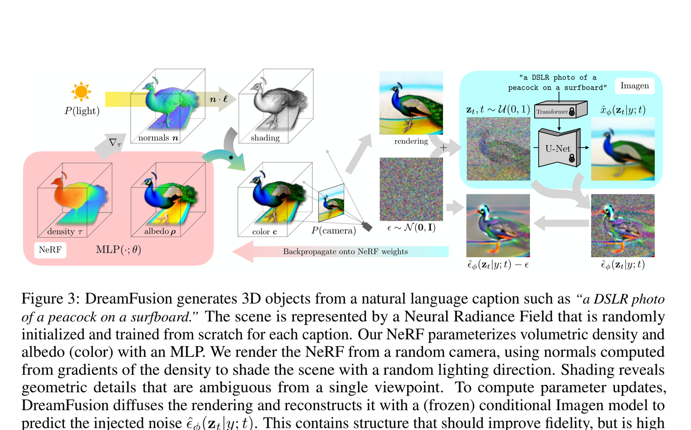

- NeRF 渲染 → 加噪 → 冻结扩散模型 → 去噪 → 参数更新，形成闭环。
- 3D 孔雀/渲染图、扩散噪声、梯度箭头混合；图片承担大部分信息。
- PPT 适合画外层循环、箭头、文字；3D 主体作为图片导入。

### 11. BLIP-2（ICML 2023）— 两阶段 + 冻结编码器

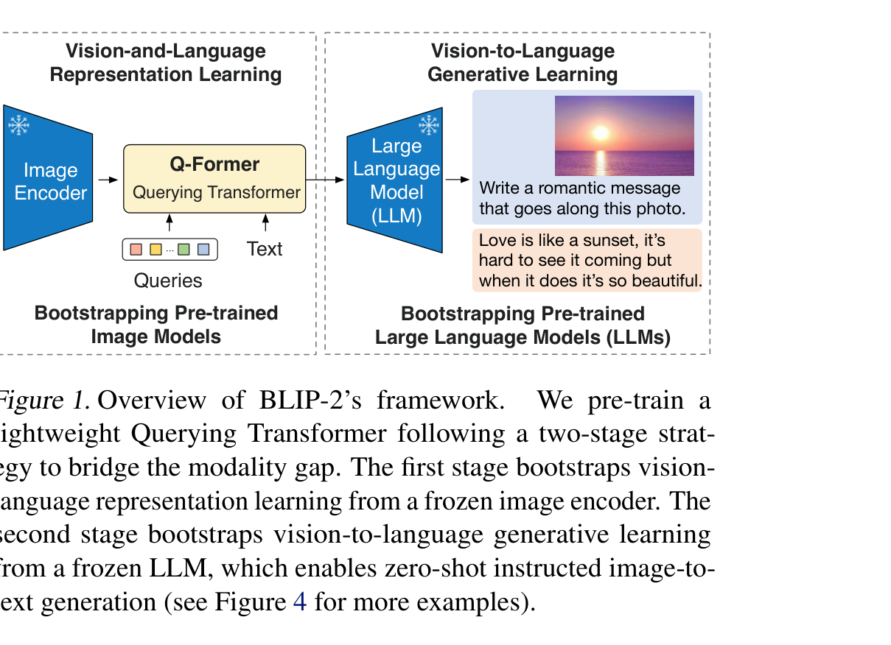

- 两个灰色虚线大框 = 两个训练阶段；蓝色梯形 + 雪花 = 冻结 image encoder / LLM。
- 黄色 Q-Former、彩色 query 小方块、文本/图片示例；箭头非常简洁。
- 这是“两阶段/冻结-可训练”图型的最佳模板之一。

### 12. Consistency Models（ICML 2023）— 轨迹/映射

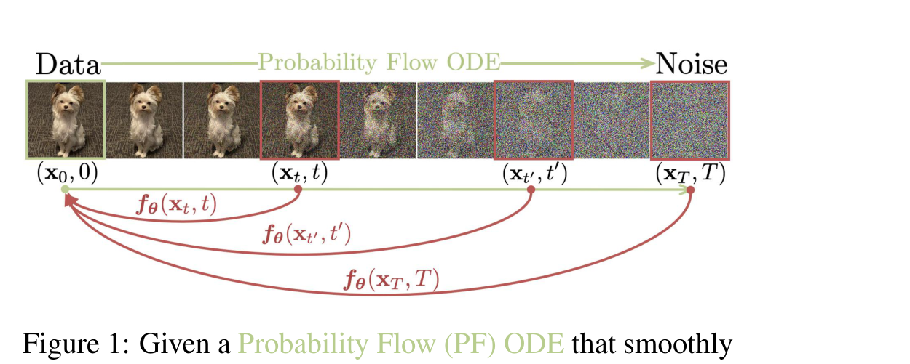

- 顶部图像条从 data → noise；绿色箭头表示 PF ODE 前向轨迹；红色弧线表示任意点映射回原点。
- 一张图只解释一个核心思想：consistency mapping。
- PPT 可用图片条 + 曲线连接符 + 数学标签复刻；不需要复杂模块。

### 13. SOIT（AAAI 2022）— 特征金字塔 + 多任务分支

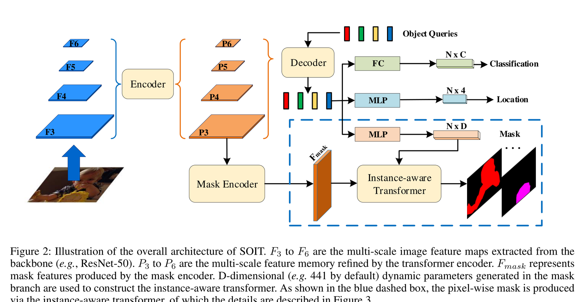

- 左侧蓝色 F3–F6、橙色 P3–P6 特征金字塔；右上 query 色条；右下蓝色虚线框放大 mask 分支。
- 同色系区分 backbone/neck；分支输出 classification/location/mask。
- 模块大小严格一致，箭头尽量水平/垂直。

### 14. EOV-Seg（AAAI 2025）— 主图 + 图例 + 双放大

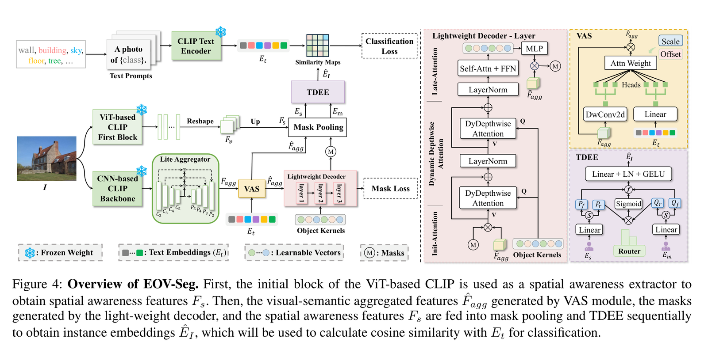

- 左侧主流程 + 右侧两个放大面板（decoder layer / VAS / TDEE）；底部有完整图例：冻结/文本嵌入/可学习向量/mask。
- 颜色不是装饰，而是语义：绿色=冻结 CLIP，紫色=decoder，黄色=VAS，灰色虚线=loss。
- 信息密度高，但图例和面板边界让读者能分层阅读。

### 15. 3D Gaussian Splatting（SIGGRAPH 2023）— 极简流程 + 双箭头语义

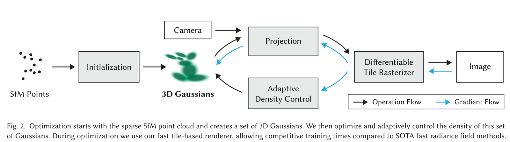

- 黑色细框 + 黑/蓝两套箭头：黑色=operation flow，蓝色=gradient flow；右下角图例。
- 3D Gaussian 用真实渲染缩略图，其他全是矩形框；非常 PPT 友好。
- 这是“前向/梯度”双流图的最佳模板。

### 16. Instant NGP（SIGGRAPH 2022）— 五步机制图

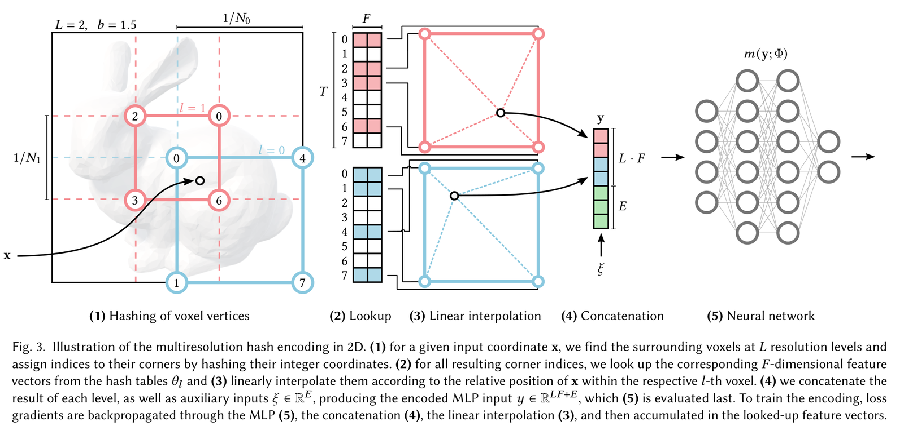

- 5 个编号步骤：voxel hashing → lookup → interpolation → concatenation → MLP。
- 网格、哈希表、颜色条、半透明 3D 兔子、MLP 节点图；每步都有编号和短标签。
- 适合用 PPT 的表格/矩形/箭头/半透明图片复刻；复杂 3D 兔子作为背景图。

---

## 从 16 篇图里得到的硬规则

### 1. 布局

- 双栏图：`7.16 × 2.4–3.2 in`；单栏：`3.5 × 2.2–2.8 in`；3D/teaser 可到 `3.4 in` 高。
- 一条水平主流程，4–7 个模块；主路径不上下折返。
- 模块高度 `0.5–0.7 in`，同一行严格等高；间距 `0.15–0.25 in`；画布边距 `0.12–0.2 in`。
- 分支只在局部展开：上方放条件/辅助输入，下方放 skip/feedback/loss；右侧开放大面板。
- 主图 + 放大面板时，左边主图占 55–60%，右边面板占 40–45%。

### 2. 形状语义

| 形状 | 含义 | 例子 |
|---|---|---|
| 圆角矩形 | 模块/操作 | encoder、decoder、fusion |
| 直角矩形 | 张量/特征/图像 | feature map、token、image |
| 梯形 | 冻结编码器/卷积/压缩 | BLIP-2 image encoder、SAM conv |
| 小方块阵列 | token/query/embedding | VGGT、SOIT、BLIP-2 |
| 平行四边形/堆叠 | 多尺度特征金字塔 | SOIT、VGGT |
| 虚线圆角框 | 阶段/重复/可选模块 | VGGT ×L、BLIP-2 两阶段 |
| 虚线矩形 | 新增模块/损失 | HQ-SAM、EOV-Seg |
| 半透明 3D 体 | Gaussian/场景/渲染 | 4DGS、NeRF、DreamFusion |

### 3. 颜色

- 最多 3 个主色 + 1 个强调色；同一语义必须同色。
- 填充浅（85–95% 亮度），描边同色系深 20–30%；文字深灰/近黑。
- 冻结 = 蓝/灰 + 雪花或 `frozen` 标签；可训练 = 橙/桃；损失 = 红；梯度 = 青/蓝；可选 = 虚线。
- 不要用高饱和红绿蓝、渐变、阴影、发光；不要超过 4 个色相。
- 如果颜色承载语义（EOV-Seg），必须加图例；如果只是分类，颜色要克制。

### 4. 箭头

- 前向/操作流：深灰 `0.75–1.25 pt` 实线，实心三角箭头。
- 梯度/反传：青色/蓝色，可加粗或弯曲；最好加图例（3DGS）。
- 可选/未标注/反馈：虚线；反馈回路用 `add_detour` 走外侧，不穿模块。
- 箭头端口对齐；同一模块多个输出要扇形分配端口；不要从模块中心随意发散。
- 箭头标签只写操作名（`sup`、`fuse`、`sample`），8–9 pt，白底压线。

### 5. 文字

- 模块 9–11 pt；子标签 8–9 pt；图例 8 pt；**不小于 8 pt**。
- 短语/名词，不写完整句子；公式只在必要时出现，复杂公式作为图片导入。
- 图内不放标题和图注；图注交给 LaTeX。面板编号 `(a)(b)` 可以放。
- 冻结/可训练用雪花/火焰或 `frozen`/`trainable` 小标签；不要用 emoji 作为唯一语义。

### 6. 图片与 3D

- 输入/输出优先真实图片、深度图、点云、渲染图；它们比文字框更有信息量。
- 结果网格：图片等大、无间距或 1–2 px、统一裁切；不要给每张图加粗边框。
- 3D 主体（NeRF/4DGS/DreamFusion/3DGS）用 Blender/论文代码/Matplotlib 渲染后导入；PPT 只画外层流程、箭头、标签。
- 不要把 3D 渲染硬拆成一堆 PPT 形状；也不要用 AI 生成位图冒充架构图。

### 7. 图例与面板

- 语义超过 3 种时加图例（EOV-Seg、3DGS）；图例放底部或右下角，8 pt。
- 放大面板用同色系标题条 + 细边框；面板内只保留 3–5 个模块。
- 两阶段图用两个虚线大框，标题在框上方/左上；不要用两个实心大色块压住内部模块。

---

## 图型 → 程序操作

| 图型 | 推荐 ops |
|---|---|
| 单主干 pipeline | `add_picture` → `add_shape` ×4–6 → `add_container` → `add_connector` ×N → `add_text` → `fit_canvas` |
| 冻结/可训练 | `add_container` ×2（虚线）→ `add_shape`（梯形/矩形）→ `add_text`（frozen/trainable）→ `add_connector` |
| 逐步机制 | `add_shape`（编号步骤）→ `add_picture`（小图）→ `add_connector` → `add_text` |
| 主图+放大 | `add_container`（主图）→ `add_container` ×2（面板）→ `add_shape`/`add_connector` |
| 结果网格 | `add_image_grid` → `add_text`（列标签） |
| 3D/概念 | `add_picture`（渲染图）→ `add_text` → `add_connector`（少量） |
| 轨迹/映射 | `add_image_grid`（1 行）→ `add_connector`（曲线/折线）→ `add_text`（公式） |

更具体的尺寸、配色、检查清单见 [`docs/figure_playbook.md`](../docs/figure_playbook.md)。

## 不要做

- 不要用 AI 生成位图来冒充架构图——文字糊、不可编辑、不可复现。
- 不要把整张图导出成图片再塞回 PPT——人就没法改。
- 不要用 PPT 形状硬画 3D 场景/真实渲染图——这类内容应作为图片导入。
- 不要在结果网格上加阴影、粗边框、渐变背景。
- 不要让 LLM 直接写 OOXML——用受控的语义操作 API，失败可定位、可回滚。
